# КТ-12 - Отношения один к одному

Студент - Денисенко Даниил Евгеньевич  
Группа - 4п4.23 NET  
Дисциплина - ADO.NET  

### Задания

Создайте систему управления профилями пользователей. Каждый пользователь будет иметь один профиль, а каждый профиль будет связан с одним пользователем. Проект будет включать создание моделей данных, настройку отношений один к одному, реализацию CRUD операций и создание пользовательского интерфейса.

**1. 1 Создание моделей данных:**

- Создайте модели User и UserProfile.
- Настройте отношения один к одному между User и UserProfile.

**1. 2 Настройка базы данных:**

- Используйте атрибуты и Fluent API для настройки моделей данных.
- Настройте каскадное удаление для отношений один к одному.

**1. 3 Создайте CRUD операции для управления пользователями и их профилями.**

### Задание 1

Создал модели User и UserProfile, связал их по UserId
У каждого пользователя один профиль, их ID совпадают

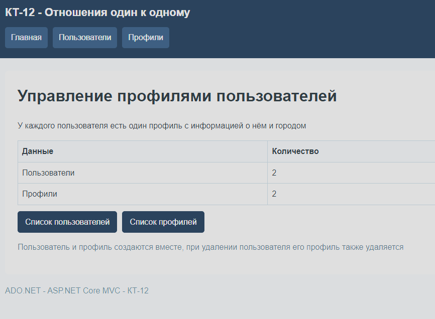

На главной странице показано количество пользователей и профилей

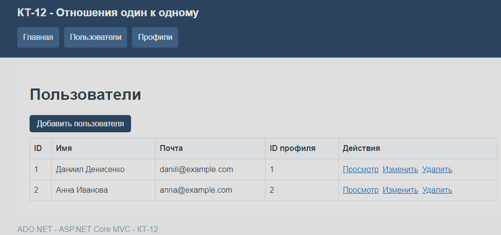

В списке видны имя, почта и ID связанного профиля

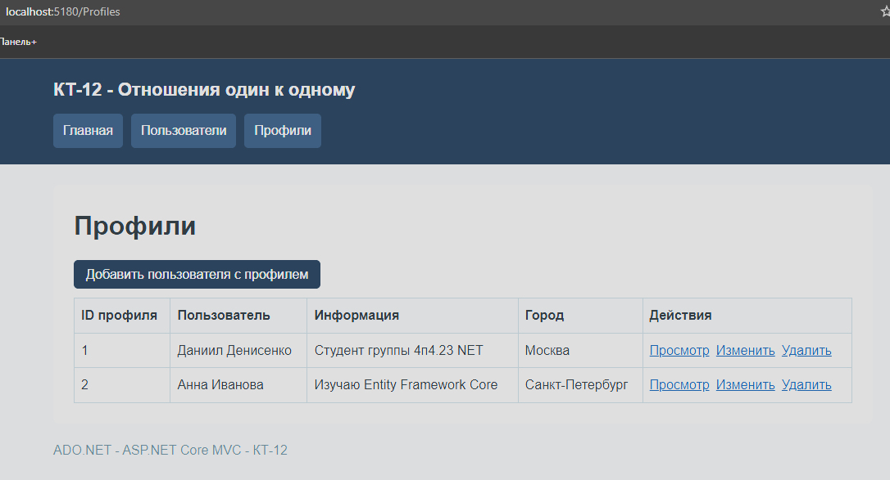

У каждого профиля указан его пользователь, описание и город

### Задание 2

Данные хранятся в SQLite
Ключи указал атрибутами, связь и каскадное удаление настроил через Fluent API
UserId в профиле является первичным и внешним ключом, поэтому второй профиль с тем же ID добавить нельзя

### Задание 3

Добавил просмотр, создание, изменение и удаление
Пользователь создаётся вместе с профилем, профиль можно редактировать отдельно
При удалении пользователя связанный профиль удаляется из базы

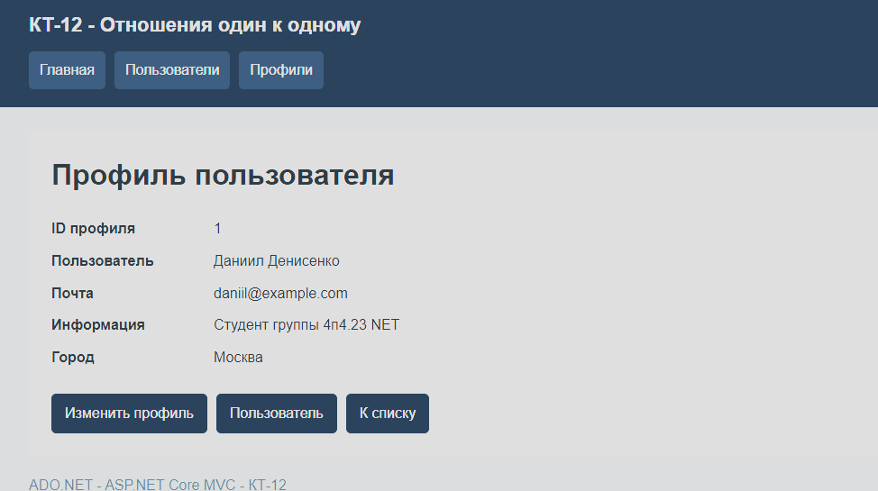

На странице пользователя показаны его данные и связанный профиль

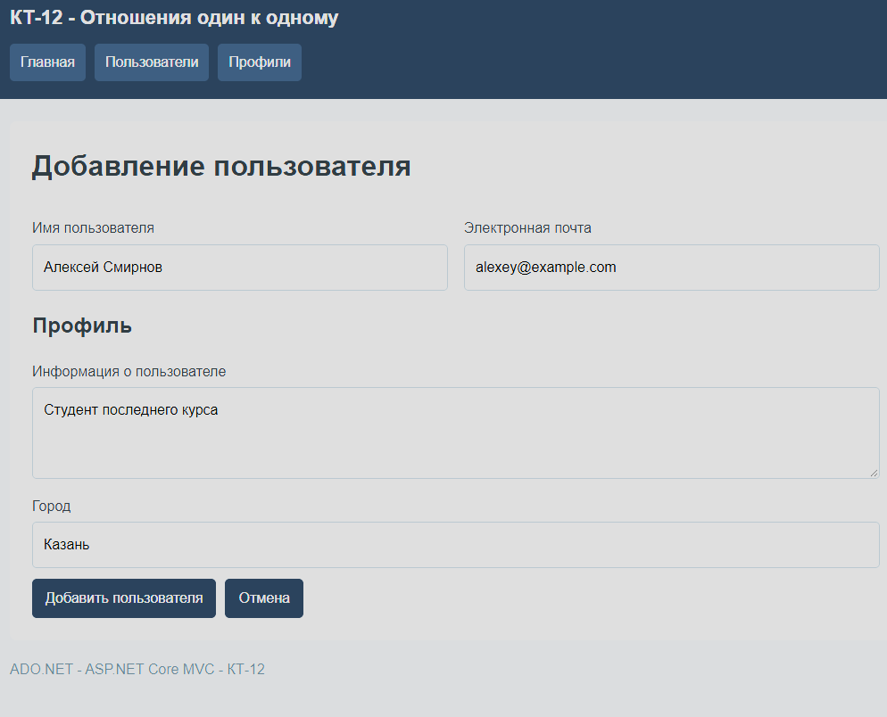

Форма содержит имя, почту и данные нового профиля

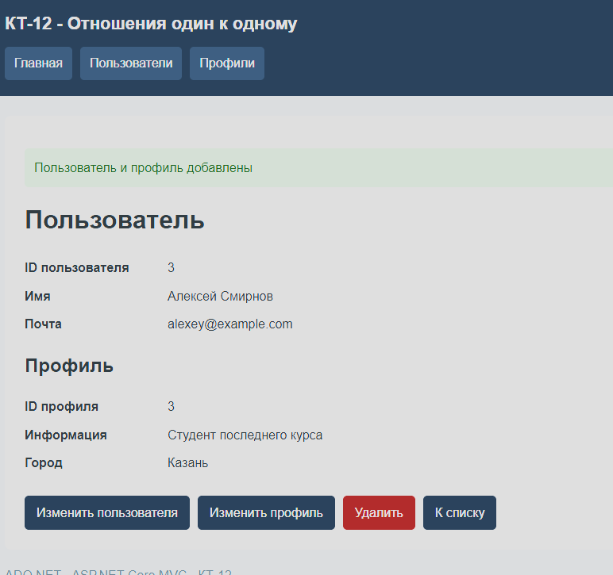

Пользователь и профиль сохранены, их ID совпадают

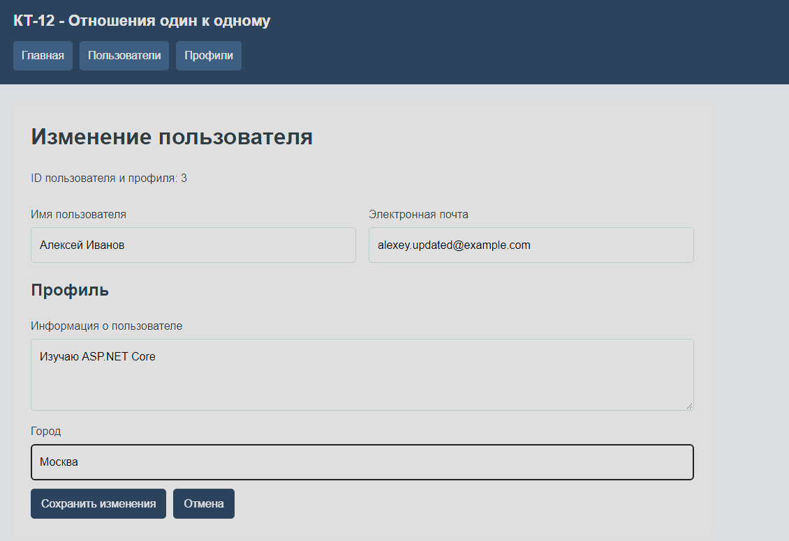

В форме изменены имя, почта, описание и город

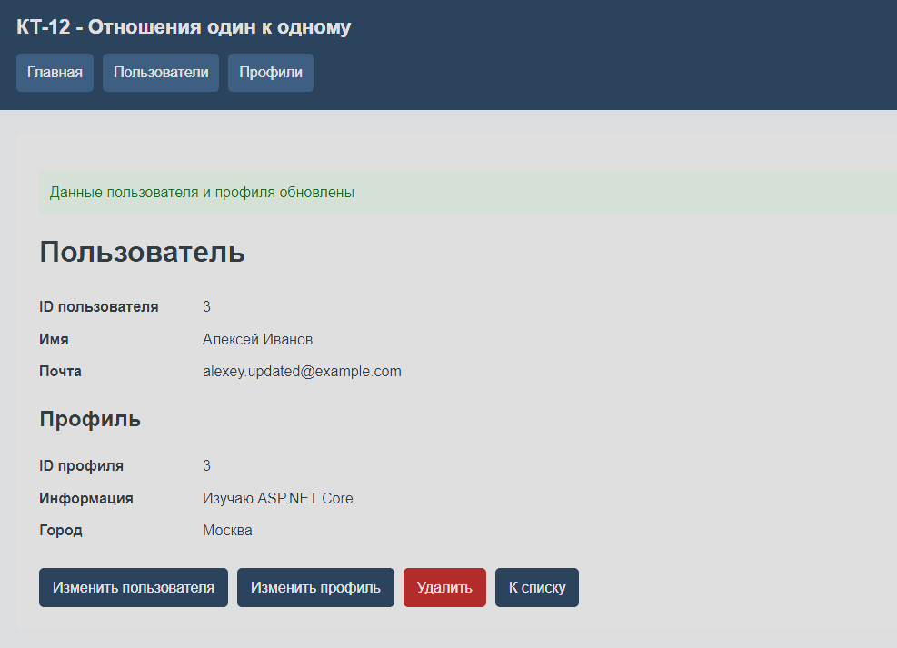

Новые данные пользователя и профиля сохранены

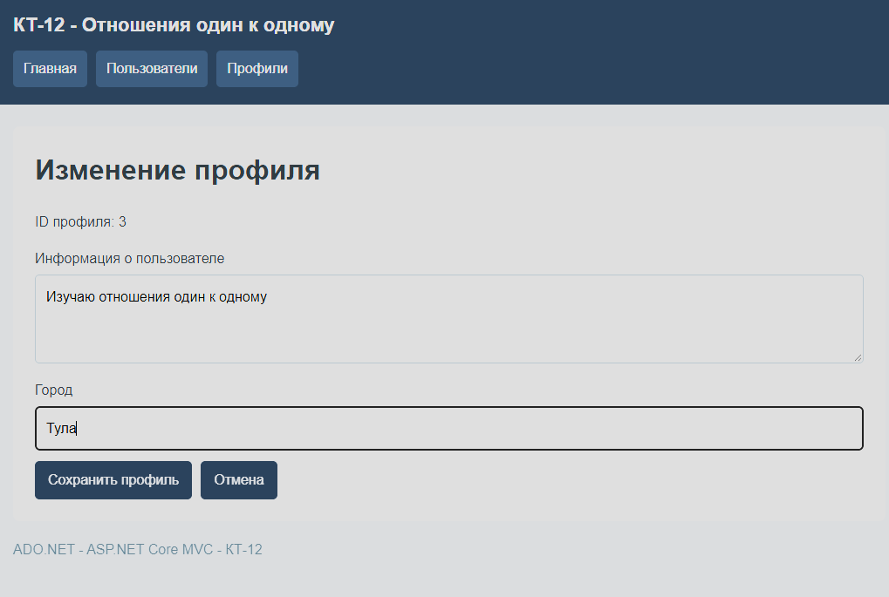

Отдельная форма позволяет изменить описание и город

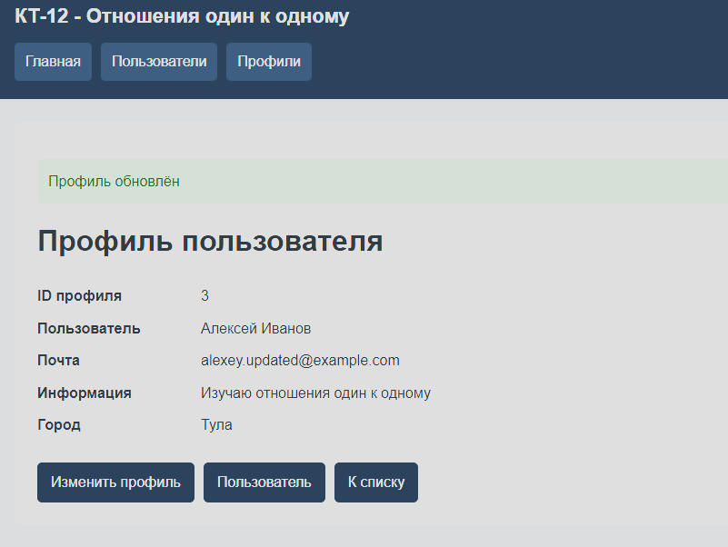

Профиль обновлён, имя и почта пользователя остались прежними

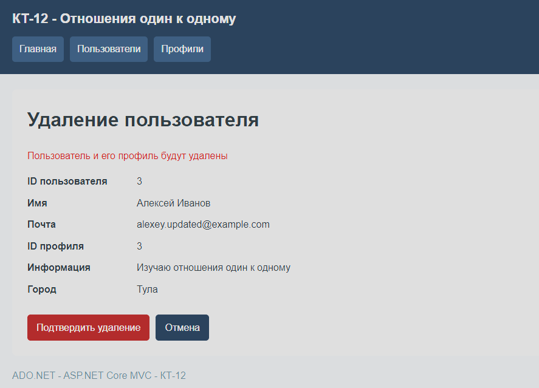

Перед удалением показаны данные пользователя и его профиля

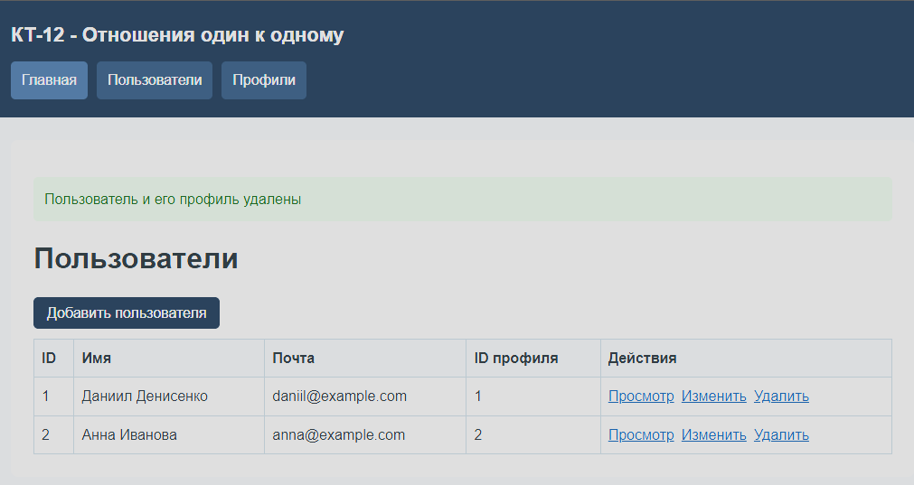

Удалённого пользователя больше нет в списке

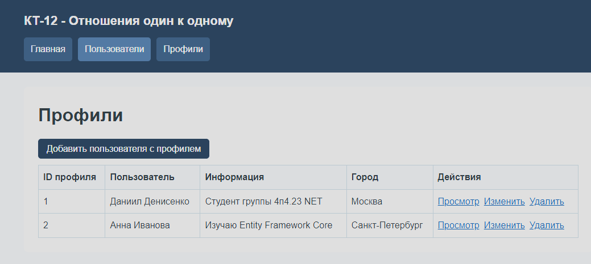

Связанный профиль также исчез из списка

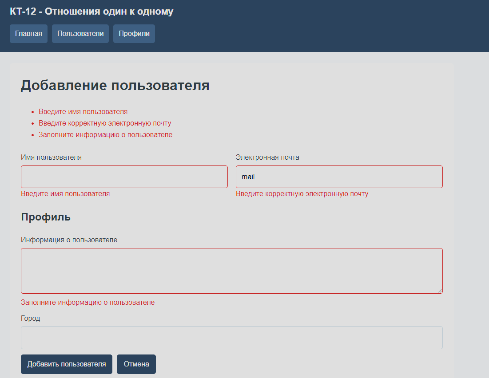

При неверном заполнении формы показаны ошибки, запись не сохраняется
